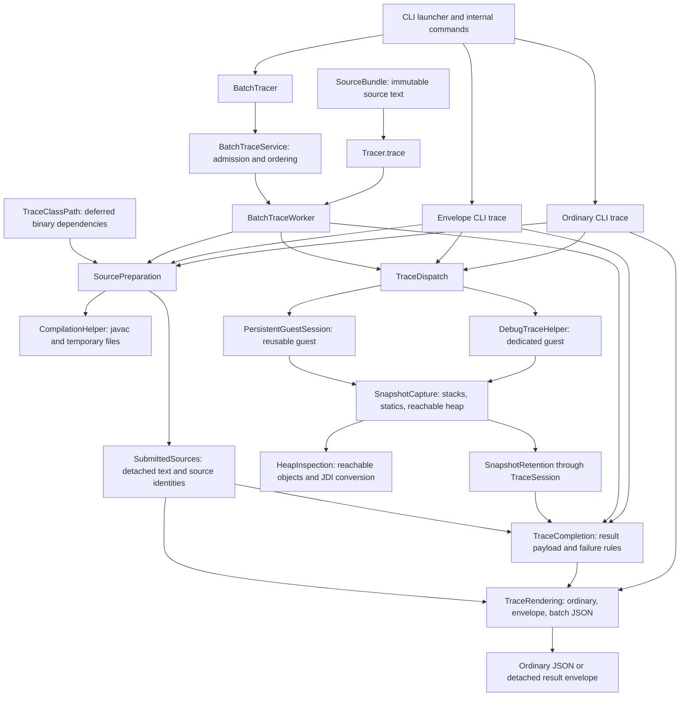

# Architecture

The tracer compiles submitted Java programs, executes them in a guest JVM through
JDI, captures stacks and reachable heap objects, and renders Python Tutor or modern
JSON. Guest execution does not establish host isolation. The
[runner contract](../RUNNER_CONTRACT.md) defines separate hosting requirements.

Shared implementation terms and ownership rules are defined in the repository-root
[contributor glossary](https://github.com/cs1302uga/cs1302-tracer/blob/main/GLOSSARY.md);
user-facing terms are in the [glossary](../reference/glossary.md).
The [internal tracing guide](../guides/java-module-migration.md) describes contributor
call conventions; [Java integration](../reference/java-api.md) describes the supported
consumer interface.

## Entry points and execution flow

The supported interface is `cs1302.tracer.api`, plus the CLI launcher
`cs1302.tracer.App`. The executable JAR first enters the Java-8-compatible
`CliBootstrap` to diagnose unsupported runtimes. Supported launcher calls and
that bootstrap converge on `cs1302.tracer.internal.App`, which runs
`CliEnvironment` preflight before dispatching Picocli commands. Preflight owns
tool selection, bounded version probes, and running-JDK identity checks; it does
not change the JVM or apply to supported tracing API calls. The command class, parser ASTs, debugger objects,
wire models, and serializer configuration are internal implementation details.

`SourceBundle` assembles explicitly supplied source text before tracing. Its builder
captures individual files or caller-selected glob matches when added, owns ordered
logical paths and delimiter framing, and produces an immutable value with text and
UTF-8 exports. It does not prepare
classes, discover dependencies, or execute guests. Callers pass its `source()` to
the existing `TraceRequest` interface.

`Tracer.trace` resolves a typed `TraceRequest` into an internal `TraceJob` and passes
it directly to the shared worker, without a wire-model conversion. It closes its
worker before returning a detached `TraceOutcome`. The Java caller profile selects
submitted-source discovery with compiled-source resolution. Single-stack requests use a persistent
guest owned for that operation; multithread requests use a dedicated guest.
Because each call owns its worker, thread-bound `TraceSession`, source preparation,
and guest, independent `Tracer` calls may run concurrently; see
[concurrent calls](../reference/java-api.md#concurrent-calls).

`BatchTracer` owns the NDJSON processor. `BatchTraceService` handles admission,
worker scheduling, correlation, and response ordering. Each `BatchTraceWorker`
executes jobs sequentially and owns guest reuse/recycling. Multithread jobs close
any reusable guest and use a fresh guest. The CLI batch command uses `BatchTracer`.

Ordinary and envelope CLI tracing use dedicated guests. Ordinary output preserves
mode-specific roots, while envelopes contain a sequence root and status metadata.
`TraceRendering` owns ordinary root selection, sequence payload conversion, and final
JSON encoding for detached outcomes and batch responses. Execution supplies status and
diagnostics; batch processing supplies correlation, orders responses, and writes records.
`TraceCompletion` selects sequence-payload snapshots and rendering-failure precedence
for envelope CLI and Java/NDJSON worker results. Ordinary CLI renders its completed
capture directly. Completion coordinates rendering without taking over execution,
source preparation, output detachment, or result classification.

`Tracer.discoverBreakpoints` prepares submitted sources and reads class-file line
tables without launching a guest. CLI `list-breakpoints` also reads line tables,
with its file-input source-discovery behavior.

`TraceJob` resolves caller-specific defaults, effective inspection, source discovery,
capture intent, and presentation settings. Its Java, ordinary CLI, envelope CLI,
and NDJSON profiles preserve their existing contracts. The NDJSON adapter alone
interprets wire values and attaches request correlation. Breakpoint text stays
unparsed until each caller's established validation point: before source access
for CLI commands, and after compilation for Java and NDJSON jobs. Guest ownership,
session accounting, cancellation, and rendering stay with their existing owners.

## Package responsibilities

| Package | Responsibility |
| --- | --- |
| `cs1302.tracer.api` | Source bundles, binary dependency configuration, supported requests, detached outcomes, limits, presentation choices, discovery, and batch processing. |
| `cs1302.tracer` | Supported CLI launcher. |
| `cs1302.tracer.internal` | CLI commands, submitted source identity, source delimiters and naming, portable glob matching and file selection, preparation, compilation, and license notices. |
| `cs1302.tracer.internal.classpath` | Deferred binary dependency preparation, manifest closure, correlated dependency/archive-view ownership, copying, and bytecode type resolution. |
| `cs1302.tracer.internal.trace` | Guest launching/execution, snapshot assembly, reachable-heap inspection, captured values, source observations, type inference, input observation, and job output. |
| `cs1302.tracer.internal.execution` | Session lifecycle, budgets, cancellation, snapshot retention, job resolution/options, caller-specific trace completion, and internal result envelopes. |
| `cs1302.tracer.internal.batch` | NDJSON request/response models, bounded scheduling, and workers. |
| `cs1302.tracer.internal.guest` | Persistent harness and prepared-dependency loaders for persistent and dedicated guest JVMs. |
| `cs1302.tracer.internal.model` | Source, breakpoint, and primitive binary metadata; `modern` and `pytutor` subpackages hold wire models. |
| `cs1302.tracer.internal.serialize` | Trace rendering: root selection, format conversion, JSON policy, and detached outcomes. |

Supported types declare API Guardian `STABLE`, and public implementation types
(including nested types) declare `INTERNAL`. Existing types date their status to
4.0.0; new types and builders introduced in 4.1.0 date it to 4.1.0. API Guardian annotations
are the sole permitted external metadata in supported declarations. Exposure tests
reject other third-party/internal types, including in generics and annotations.
Public internal classes remain accessible on the classpath and through the automatic
module, but are outside the supported compatibility contract and public **Javadoc**.

Builders stay with their owning values: requests preserve caller settings, limits
reuse the existing presets and validation, and wire values preserve nullability and
ordering. They detach immediate collections without recursively copying payloads or
changing existing constructor ownership. Trace-job resolution still interprets raw
settings; serializers still assemble correlated step fields; trace rendering still
freezes coherent outcomes. `BatchTracer.Builder` records explicit resource settings,
while existing batch construction validates ranges and allocates independently owned
processors. See [Java integration](../reference/java-api.md#build-and-customize-values)
and [internal value construction](../guides/java-module-migration.md#building-internal-values).

## Source preparation and observations

`SourceBundle` validates transport structure without requiring explicitly named
source text to be valid Java. `SourceDelimiters` remains the authority for the
existing delimiter grammar, including collision detection. `SourceNames` shares
source-name inference with `CompilationHelper`: bundle inference can use a sole
non-public top-level type, while legacy undelimited input still requires exactly
one public top-level type. Inference does not select an entry point. Logical path
validation and immutable bundle construction belong to `SourceBundle`; compilation
continues to validate actual output destinations independently. See
[source bundle construction](../reference/java-api.md#bundle-source-files) for
framing, UTF-8, and file ownership contracts.

Bulk file additions keep matching, filesystem selection, and captured state with
separate owners. `SourceGlob` parses the portable root-relative grammar before any
traversal and matches paths using bounded states rather than host-specific glob
semantics or expanded combinations of brace alternatives. `FileSelection` owns the
resolved traversal root, regular-file selection, symbolic-link policy, encountered
relative paths, and lexical ordering. It detects cycles along active ancestry,
so separate aliases to one physical file remain separate candidates. Following
links may visit targets outside the root, and traversal errors abort selection
even when the failing path would not match. `SourceBundle.Builder` stages captures
through the existing naming, UTF-8, delimiter, and duplicate checks, then commits
the entire group only after success. Atomicity applies to builder state; selection
and reads do not provide a simultaneous filesystem snapshot. Source preparation's
dependency-discovery policy and compilation lifecycle remain independent of this
explicit file collection. Its named `sources` and `dependencies` operations share
one traversal implementation. Source matches pair portable logical names with
paths beneath the resolved traversal root for immediate reading. Dependency matches
project the same encountered relative paths onto the caller's original normalized
root, preserving root aliases for dependency identity and manifest references.
Native relative path components are retained when constructing filesystem paths.

`CompilationHelper.parseSources` returns one `ParsedSources` containing the parsed
submitted files and their correlated `SubmittedSources` description. The description
retains exact original input and per-file text, ordered logical and debug paths,
and entry selection without retaining ASTs or resources. `SourcePreparation`
retains it alongside compiled classes, parsed source evidence, and one
`PreparedClassPath` until tracing finishes. The prepared class path owns both
effective dependency locations and their host archive views. Closing source
preparation releases compiled output before closing the dependency owner, which
closes readers before removing owned copies. Preparation failures keep the original
failure primary and retain cleanup failures as secondary evidence.
`CompilationHelper` splits delimited bundles, identifies the entry point, validates
source destinations, and invokes javac with debug information. It returns a
closeable compiled-program description; source evidence is reparsed with symbol
resolution under the selected discovery policy. Normal preparation resolves
dependencies before parsing source. CLI listing parses first and passes that
same correlated result to `prepareParsed`, preserving its source-error precedence.

Prepared rendering and CLI listing reuse the detached description without parsing
source identity again. Logical destinations remain distinct from package-relative
debug identities. Compiler destination checks run during preparation; duplicate
debug identities fail only when rendering requests `SubmittedSources.metadata()`.
Each failed projection creates a fresh exception, including on worker recovery.
Listing retains its exact logical/native lookup and first basename-suffix fallback
when the exact line set is empty. Raw-source rendering uses the same parser and
identity implementation without requiring compilation or a launchable main method.
See [submitted source identity](../guides/java-module-migration.md#submitted-source-identity)
for rendering order and internal call conventions.

`TraceClassPath` records ordered literal paths and explicit glob selections without
reading files. Each operation resolves them during preparation. `PreparedClassPath`
selects and sorts pattern groups, follows local manifest dependencies in search
order, and optionally captures their available transitive closure. Original locations
remain the base for manifest references and diagnostics; effective locations
identify borrowed inputs or owned copies. Duplicate normalized absolute paths keep
their first position; distinct physical aliases are not collapsed. JAR contents
and signatures remain intact, including when manifests use absolute local URLs.
`FileSelection.dependencies` supplies dependency glob matches during preparation;
`ClassPathFiles` owns directory copying and owned-tree deletion. Source capture
remains immediate, while dependency selection remains deferred until each job.

The prepared owner opens archive views only after selection, manifest expansion,
and optional copying finish, before parsing or compiling submitted sources.
Its internal `BinaryClassPath` implementation exposes JARs as runtime-version
ZipFS directory views, preventing javac from expanding their manifests again.
The internal compilation interface accepts the prepared owner instead of unrelated
guest-location and host-root lists, so callers cannot pair different selections.
Readers remain available through lazy type analysis and guest execution.
The compiler uses an empty processor
path and `-proc:none`; generated sources must be supplied explicitly. A job-local
`BinaryTypeSolver` reads those same selected class files through Javassist without
loading dependency classes into the host tracer. Compiled output takes application
precedence over dependencies. The output root remains separate from the effective
dependency list and owns only compilation artifacts.

Dependency-aware dedicated guests install `GuestSystemClassLoader` while retaining
native JVM main invocation. Persistent jobs create a new `GuestClassLoader` for
each request. Both use the prepared paths without re-expanding manifests, delegate
to platform classes first, and retain signature verification, package sealing,
multi-release selection, resources, and services. Defining/context-loader lookup
is supported; `getSystemClassLoader()` and `java.class.path` need not describe the
job identically in persistent and dedicated modes. Existing no-dependency launch
paths are retained. Libraries do not gain source-line breakpoints; dependency
objects and stack frames remain subject to existing capture rules.

Borrowed locations must stay available and unchanged. Copying captures files before
compilation, but is not an atomic snapshot of a concurrently changing filesystem.
Source-byte/file budgets do not bound binary dependencies or copied resource trees.
See [binary dependencies](../reference/java-api.md#binary-dependencies) for caller
configuration and ownership rules.

Discovery is caller-specific. Trusted ordinary CLI and batch tracing permit
neighbor discovery with compiled-source fallback; bounded CLI uses neighbor
discovery without that fallback. One-shot Java tracing permits submitted sources
with compiled-source resolution. Field-only inspection and supported breakpoint
discovery restrict evidence to submitted sources. These policies are not identical;
see the [internal guide](../guides/java-module-migration.md) for the four choices.

`SourceAnalysis` builds source indexes, final-variable observations, and lambda
implementation text. Capture requests observations for a declaring class, method,
argument types, and source line. Method matching and location-sensitive lambda
selection remain with source analysis, including the first-assignment fallback.
Lambda rendering uses a call-local parser, so independent workers do not share
mutable parser state. `AstTypeResolver` holds source-derived type indexes and lazily
supplements them with immutable class-file descriptors and signatures supplied by
the prepared job's `BinaryTypeSolver`. That solver reuses its ordered bytecode
lookup and class pool without loading dependency classes into the host JVM.
Binary declaration caches and hierarchy composition retain exact binary identities;
canonical display names require evidence that they resolve to the same declaration.
This preserves legal `$` identifiers and distinguishes a nested class from a
different class whose package produces the same dotted spelling. Generic hierarchy
traversal composes superclass and interface arguments; heap inspection resolves
each instance field against its JDI declaring owner. These declaration caches belong
to the job, while snapshot-specific bindings remain with the type evidence described
below. Binary declarations do not add library source listings or source-line
breakpoints.

`BreakpointReader` uses ASM to read SourceFile and line-number attributes without
loading or executing guest classes. All compiled classes contribute to its index,
including unused nested classes and records. The build targets Java 21; the active
**JDK**, parser, and bytecode-reader support together constrain guest compatibility.
Dependency versions are selected in `pom.xml`.

## Capture and reified type metadata

`TraceDispatch` selects final-state, selected-breakpoint, or chronological capture
without rendering output. Its dedicated and persistent adapters retain distinct
launch, event-loop, cleanup, and reuse rules. Multithread capture uses dedicated
execution and `ThreadCapture`; it observes application threads and invokes no guest
methods during inspection.

`SnapshotCapture` constructs complete `ExecutionSnapshot` values from stacks, static
fields, and a reachable heap. Dedicated and persistent execution call the same capture
operation with suspended threads, source/input observations, and the job output owner.
Capture owns output synchronization, all-thread type prepasses, stack/static extraction,
root type evidence, and the final session admission call. One package-private
`HeapInspection` per snapshot owns JDI conversion, reference admission, FIFO traversal,
descendant discovery, and the heap map. All captured threads share it and the same
`ReifiedTypeMetadata`. Admitted identities remain known after dequeue, preserving
sharing and cycles. Source-observed lambda text is installed before traversal and
retains precedence. Successful inspection transfers its existing map to the snapshot;
a failed inspection publishes no partial snapshot. Thread-local `TraceSession`
access remains in place for budgets and completed-snapshot admission. Guest launch,
event handling, suspension, and cleanup remain with execution. `TraceValue` contains
captured host-owned values, without JDI inspection. Trusted inspection has specialized
collection, map, wrapper, and lambda
representations. Field-only inspection avoids those guest method calls and uses
raw fields for ordinary objects. Arrays, strings, and `java.awt.Color` retain
dedicated handling; field-only color inspection reads the stored color value
without invoking a guest method.

`ReifiedTypeMetadata` owns inferred object types and dependent frame bindings for
one snapshot. All captured threads share it. Callers submit fallback or refined
evidence instead of mutating a map or invalidating bindings. Frame bindings are
read-only. `InvocationTypeResolver` contributes source-based method substitutions.

Hidden binary lambda objects retain observed functional-interface views separately
from concrete runtime type evidence. Reference observations verify actual JDI
interface membership and a resolvable single abstract method. `HeapInspection`
finalizes these object headings after traversal, using the interface type with a
`λ` presentation marker only when the accumulated evidence supports it.
This keeps late field evidence effective without feeding display markers into
generic substitution or changing source-reconstructed lambda bodies.

Fallback evidence fills missing entries. Refinement preserves runtime-name,
generic, and concrete-over-wildcard precedence; conflicting concrete arguments
retain the earlier candidate. All captured threads finish their type prepasses
before stack rendering, followed by heap traversal. Refinement does not rewrite
already-rendered values. These descriptions are conservative evidence, not recovery
of erased runtime generic arguments; see [type labels](../reference/output.md#generic-method-variable-types).

## Per-job input and output

`InputObservation` owns standard-input identity, supported reader recognition,
nested-read suppression, and the logical consumed-input cursor for one job.
`InputTracker` maintains cursor progress, including UTF-16 offsets. Guest execution
owns event processing and reader-request cleanup. Each job gets a fresh observation,
including when its guest is reused.

`JobOutput` owns stdout/stderr ranges and leading JVM-banner filtering. Persistent
execution starts after previously drained bytes; dedicated execution starts at zero.
Capture samples prefix lengths and byte cost together. Execution establishes guest
completion and requests draining before finishing output.

Finishing returns immutable output and is idempotent. Retained snapshots are detached
onto prefixes of that output before reusable drainers reset. `PersistentGuestSession`
returns finished output from job cleanup. `TraceSession` and `SnapshotRetention`
decide whether trailing output fits the budgets; guest termination and reuse stay
with the execution path.

## Budgets and snapshot retention

`TraceSession` owns cancellation, the tracing deadline, guest/process attachment,
output drainers, first stop reason, and access to retained snapshots. Its thread-local
binding bridges internal extraction helpers; it is not inherited by child threads.
The independent watchdog can stop a guest while JDI method invocation blocks.
Supported consumers configure `TraceLimits` through requests rather than manipulating
sessions. Limits and status semantics are documented in [bounded tracing](../BOUNDED_TRACING.md).

`SnapshotRetention` owns admitted history, retained-byte accounting, replacement,
duplicate handling, and final-output projection. A rejected snapshot leaves history
and accounting unchanged. A replacement must fit while the prior state remains
charged. Completed snapshots are committed atomically; interrupted captures are
not published with partial heap graphs.

The byte counter writes internal snapshot JSON into a counting sink rather than
allocating an intermediate string. Its special-floating-point support is internal
accounting, not consumer JSON. Retained-byte accounting does not measure all host
allocations or replace an external memory ceiling.

## Trace completion

`TraceCompletion` has named envelope, worker-success, and worker-recovery operations.
Envelope completion prefers supplied snapshots and otherwise uses raw retained
history when a guest was launched; available empty history can still be rendered.
A rendering `RuntimeException` replaces an earlier envelope failure and changes the
phase to `serialize`. Worker success selects chronological capture, finalized
multithread history, or targeted retained presentation and sets `serialize` before
rendering. Worker recovery requires available, nonempty raw retained history and
preserves the original failure and phase, suppressing a rendering failure onto it.

These operations preserve their callers' resource scopes. Envelope CLI finishes
output inside source preparation and renders after preparation closes; worker
success renders inside preparation. The worker's existing recovery path can retry
rendering after success rendering or preparation cleanup fails. Envelope and worker
adapters retain the detached submitted-source description before capture, so recovery
does not need live compilation resources or a second source parse. Adapters retain
their exception scopes, interrupt handling, guest-health decisions, and final
`TraceSession.result` call after cleanup. Session result construction owns status,
diagnostics, counters, and stop-reason precedence.

Completion delegates retained presentation and accounting to `SnapshotRetention`
through the session and format conversion to `TraceRendering`. Guest execution
continues to detach output before persistent drainers reset. Envelope recovery uses
raw history even for targeted jobs; worker completion uses targeted presentation
for nonchronological jobs. These differences follow the existing caller profiles.

## Rendering and consumer formats

`TraceRendering` is the caller-facing rendering module. It selects ordinary roots,
constructs opaque sequence payloads for execution results, freezes detached outcomes,
and encodes correlated batch responses. Callers do not choose format adapters or
JSON configuration. Ordinary modern output remains indented; Python Tutor ordinary
output and result envelopes honor the requested indentation. Legacy null policies
remain distinct between ordinary modern output and envelopes.

`PyTutorSerializer` emits tagged tuple arrays, reference tuples, and auxiliary type
metadata. `ModernTraceSerializer` emits explicit stack/heap records and reference
objects. Both consume completed snapshots and source metadata. Their per-job presentation
options can request primitive binary metadata. `PrimitiveBits` derives shared
`PrimitiveBinary` descriptors from typed snapshot values without guest calls or
retained snapshot mutation; each serializer owns metadata placement. The extension
is omitted by default and does not alter existing literal values or capture budgets.
Binary strings are allocated during rendering rather than snapshot retention. Non-finite numbers
use each format's documented valid-JSON representation.
See [encoding definitions and references](../reference/output.md#encoding-definitions-and-references)
for the descriptor formats' normative specifications and informative explanations.

Ordinary CLI rendering branches on capture shape; selected-breakpoint output can be
a mapping rather than a sequence root. Envelope and batch payloads use sequence
roots and may retain completed partial snapshots. `TraceRendering` serializes the
internal result into a dependency-free, detached `TraceOutcome`. Neither supported
outcomes nor their JSON require guest or compilation resources to remain alive.
See [JSON output](../reference/output.md) and [batch protocol](../reference/batch.md)
for the consumer contracts.
