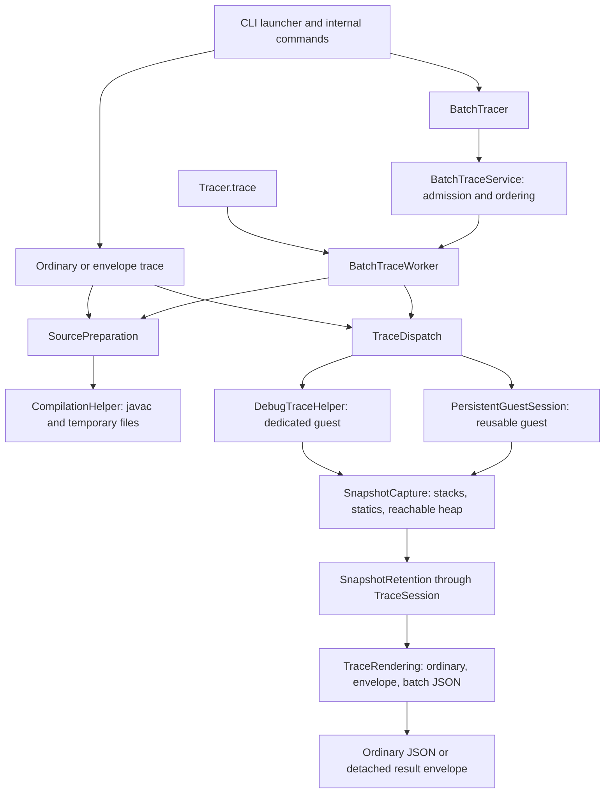

# Architecture

The tracer compiles submitted Java programs, executes them in a guest JVM through
JDI, captures stacks and reachable heap objects, and renders Python Tutor or modern
JSON. Guest execution does not establish host isolation. The
[runner contract](../RUNNER_CONTRACT.md) defines separate hosting requirements.

Shared terms and ownership rules are defined in the repository-root `GLOSSARY.md`.
The [internal tracing guide](../guides/java-module-migration.md) describes contributor
call conventions; [Java integration](../reference/java-api.md) describes the supported
consumer interface.

## Entry points and execution flow

The supported interface is `cs1302.tracer.api`, plus the CLI launcher
`cs1302.tracer.App`. The launcher delegates to Picocli commands in
`cs1302.tracer.internal.App`. The command class, parser ASTs, debugger objects,
wire models, and serializer configuration are internal implementation details.

`Tracer.trace` resolves a typed `TraceRequest` into an internal `TraceJob` and passes
it directly to the shared worker, without a wire-model conversion. It closes its
worker before returning a detached `TraceOutcome`. The Java caller profile selects
submitted-source discovery with compiled-source resolution. Single-stack requests use a persistent
guest owned for that operation; multithread requests use a dedicated guest.

`BatchTracer` owns the NDJSON processor. `BatchTraceService` handles admission,
worker scheduling, correlation, and response ordering. Each `BatchTraceWorker`
executes jobs sequentially and owns guest reuse/recycling. Multithread jobs close
any reusable guest and use a fresh guest. The CLI batch command uses `BatchTracer`.

Ordinary and envelope CLI tracing use dedicated guests. Ordinary output preserves
mode-specific roots, while envelopes contain a sequence root and status metadata.
`TraceRendering` owns ordinary root selection, sequence payload conversion, and final
JSON encoding for detached outcomes and batch responses. Execution supplies status and
diagnostics; batch processing supplies correlation, orders responses, and writes records.

`Tracer.discoverBreakpoints` prepares submitted sources and reads class-file line
tables without launching a guest. CLI `list-breakpoints` also reads line tables,
with its file-input source-discovery behavior.

`TraceJob` resolves caller-specific defaults, effective inspection, source discovery,
capture intent, and presentation settings. Its Java, ordinary CLI, envelope CLI,
and NDJSON profiles preserve their existing contracts. The NDJSON adapter alone
interprets wire values and attaches request correlation. Breakpoint text stays
unparsed until each caller's established validation point: before source access
for CLI commands, and after compilation for Java and NDJSON jobs. Guest ownership,
session accounting, cancellation, and rendering stay with their existing owners.

## Package responsibilities

| Package | Responsibility |
| --- | --- |
| `cs1302.tracer.api` | Supported requests, detached outcomes, limits, presentation choices, discovery, and batch processing. |
| `cs1302.tracer` | Supported CLI launcher. |
| `cs1302.tracer.internal` | CLI commands, source delimiters, preparation, compilation, and license notices. |
| `cs1302.tracer.internal.trace` | Guest launching/execution, capture, source observations, type inference, input observation, and job output. |
| `cs1302.tracer.internal.execution` | Session lifecycle, budgets, cancellation, snapshot retention, job resolution/options, and internal result envelopes. |
| `cs1302.tracer.internal.batch` | NDJSON request/response models, bounded scheduling, and workers. |
| `cs1302.tracer.internal.guest` | Harness running jobs inside reusable guest JVMs. |
| `cs1302.tracer.internal.model` | Source and breakpoint metadata; `modern` and `pytutor` subpackages hold wire models. |
| `cs1302.tracer.internal.serialize` | Trace rendering: root selection, format conversion, JSON policy, and detached outcomes. |

Supported types declare API Guardian `STABLE`, and public implementation types
(including nested types) declare `INTERNAL`, since 4.0.0. API Guardian annotations
are the sole permitted external metadata in supported declarations. Exposure tests
reject other third-party/internal types, including in generics and annotations.
Public internal classes remain accessible on the classpath and through the automatic
module, but are outside the supported compatibility contract and public Javadoc.

## Source preparation and observations

`SourcePreparation` owns compiled classes and parsed source evidence until tracing
finishes. It closes temporary files on completion and on preparation failure.
`CompilationHelper` splits delimited bundles, identifies the entry point, validates
source destinations, and invokes javac with debug information. It returns a
closeable compiled-program description; source evidence is reparsed with symbol
resolution under the selected discovery policy.

Discovery is caller-specific. Trusted ordinary CLI and batch tracing permit
neighbor discovery with compiled-source fallback; bounded CLI uses neighbor
discovery without that fallback. One-shot Java tracing permits submitted sources
with compiled-source resolution. Field-only inspection and supported breakpoint
discovery restrict evidence to submitted sources. These policies are not identical;
see the [internal guide](../guides/java-module-migration.md) for the four choices.

`SourceAnalysis` builds source indexes, final-variable observations, and lambda
implementation text. Capture requests observations for a declaring class, method,
argument types, and source line. Method matching and location-sensitive lambda
selection remain with source analysis, including the first-assignment fallback.
Lambda rendering uses a call-local parser, so independent workers do not share
mutable parser state. `AstTypeResolver` holds reusable source-derived type indexes.

`BreakpointReader` uses ASM to read SourceFile and line-number attributes without
loading or executing guest classes. All compiled classes contribute to its index,
including unused nested classes and records. The build targets Java 21; the active
JDK, parser, and bytecode-reader support together constrain guest compatibility.
Dependency versions are selected in `pom.xml`.

## Capture and reified type metadata

`TraceDispatch` selects final-state, selected-breakpoint, or chronological capture
without rendering output. Its dedicated and persistent adapters retain distinct
launch, event-loop, cleanup, and reuse rules. Multithread capture uses dedicated
execution and `ThreadCapture`; it observes application threads and invokes no guest
methods during inspection.

`SnapshotCapture` constructs complete `ExecutionSnapshot` values from stacks, static
fields, and a reachable heap. Dedicated and persistent execution call the same capture
operation with suspended threads, source/input observations, and the job output owner.
Capture owns output synchronization, all-thread type prepasses, stack/static extraction,
and shared heap traversal; its extraction helpers are private. Thread-local `TraceSession`
access remains in place for budgets and completed-snapshot admission. Guest launch,
event handling, suspension, and cleanup remain with execution. `TraceValue` converts
JDI values; object identities preserve sharing and cycles. Trusted inspection has specialized collection, map, wrapper, and lambda
representations. Field-only inspection avoids those guest method calls and uses
raw fields for ordinary objects. Arrays and strings retain dedicated handling.

`ReifiedTypeMetadata` owns inferred object types and dependent frame bindings for
one snapshot. All captured threads share it. Callers submit fallback or refined
evidence instead of mutating a map or invalidating bindings. Frame bindings are
read-only. `InvocationTypeResolver` contributes source-based method substitutions.

Fallback evidence fills missing entries. Refinement preserves runtime-name,
generic, and concrete-over-wildcard precedence; conflicting concrete arguments
retain the earlier candidate. All captured threads finish their type prepasses
before stack rendering, followed by heap traversal. Refinement does not rewrite
already-rendered values. These descriptions are conservative evidence, not recovery
of erased runtime generic arguments; see [type labels](../reference/output.md#generic-method-variable-types).

## Per-job input and output

`InputObservation` owns standard-input identity, supported reader recognition,
nested-read suppression, and the logical consumed-input cursor for one job.
`InputTracker` maintains cursor progress, including UTF-16 offsets. Guest execution
owns event processing and reader-request cleanup. Each job gets a fresh observation,
including when its guest is reused.

`JobOutput` owns stdout/stderr ranges and leading JVM-banner filtering. Persistent
execution starts after previously drained bytes; dedicated execution starts at zero.
Capture samples prefix lengths and byte cost together. Execution establishes guest
completion and requests draining before finishing output.

Finishing returns immutable output and is idempotent. Retained snapshots are detached
onto prefixes of that output before reusable drainers reset. `PersistentGuestSession`
returns finished output from job cleanup. `TraceSession` and `SnapshotRetention`
decide whether trailing output fits the budgets; guest termination and reuse stay
with the execution path.

## Budgets and snapshot retention

`TraceSession` owns cancellation, the tracing deadline, guest/process attachment,
output drainers, first stop reason, and access to retained snapshots. Its thread-local
binding bridges internal extraction helpers; it is not inherited by child threads.
The independent watchdog can stop a guest while JDI method invocation blocks.
Supported consumers configure `TraceLimits` through requests rather than manipulating
sessions. Limits and status semantics are documented in [bounded tracing](../BOUNDED_TRACING.md).

`SnapshotRetention` owns admitted history, retained-byte accounting, replacement,
duplicate handling, and final-output projection. A rejected snapshot leaves history
and accounting unchanged. A replacement must fit while the prior state remains
charged. Completed snapshots are committed atomically; interrupted captures are
not published with partial heap graphs.

The byte counter writes internal snapshot JSON into a counting sink rather than
allocating an intermediate string. Its special-floating-point support is internal
accounting, not consumer JSON. Retained-byte accounting does not measure all host
allocations or replace an external memory ceiling.

## Rendering and consumer formats

`TraceRendering` is the caller-facing rendering module. It selects ordinary roots,
constructs opaque sequence payloads for execution results, freezes detached outcomes,
and encodes correlated batch responses. Callers do not choose format adapters or
JSON configuration. Ordinary modern output remains indented; Python Tutor ordinary
output and result envelopes honor the requested indentation. Legacy null policies
remain distinct between ordinary modern output and envelopes.

`PyTutorSerializer` emits tagged tuple arrays, reference tuples, and auxiliary type
metadata. `ModernTraceSerializer` emits explicit stack/heap records and reference
objects. Both consume completed snapshots and source metadata. Their per-job presentation
options can request primitive binary metadata. `PrimitiveBits` derives shared
`PrimitiveBinary` descriptors from typed snapshot values without guest calls or
retained snapshot mutation; each serializer owns metadata placement. The extension
is omitted by default and does not alter existing literal values or capture budgets.
Binary strings are allocated during rendering rather than snapshot retention. Non-finite numbers
use each format's documented valid-JSON representation.

Ordinary CLI rendering branches on capture shape; selected-breakpoint output can be
a mapping rather than a sequence root. Envelope and batch payloads use sequence
roots and may retain completed partial snapshots. `TraceRendering` serializes the
internal result into a dependency-free, detached `TraceOutcome`. Neither supported
outcomes nor their JSON require guest or compilation resources to remain alive.
See [JSON output](../reference/output.md) and [batch protocol](../reference/batch.md)
for the consumer contracts.
