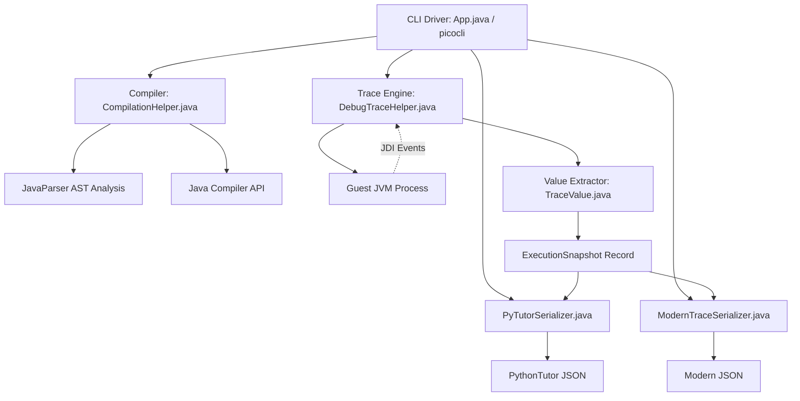
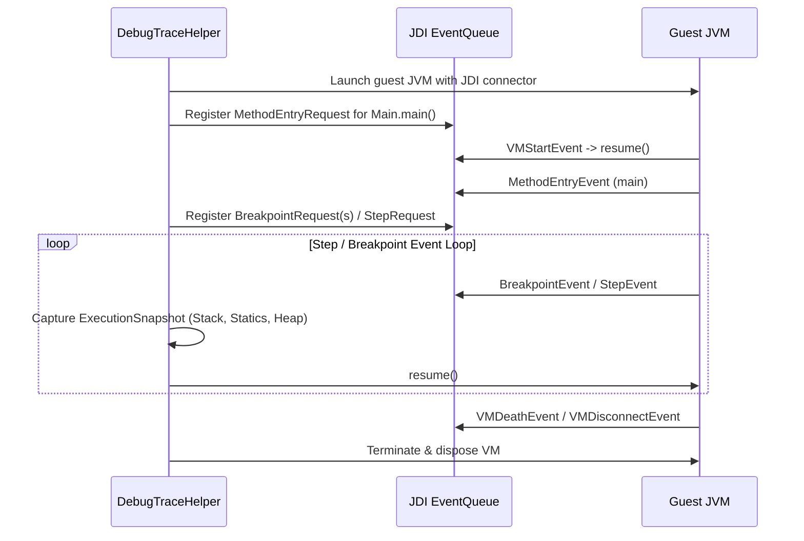

# Architecture

`cs1302-tracer` is a programmatic Java execution tracer built on top of the Java Debug Interface (JDI) and JavaParser. It compiles arbitrary guest Java code (including multi-file packages and streamed sources), executes it inside a separate guest JVM (without establishing host isolation), inspects execution states at method/line breakpoints, traverses the reachable object graph on the heap, and serializes the execution trace into JSON.

---

## Supported Java interface

The supported interface is `cs1302.tracer.api`, plus the CLI launcher
`cs1302.tracer.App`. See [Java integration and migration](../reference/java-api.md).
Parser ASTs, debugger objects, wire models, and serializer configuration belong
to `cs1302.tracer.internal` and are omitted from public Javadoc. The API exposure
check covers public/protected declarations, including generics and annotations.
API Guardian is the sole external annotation exception: supported types declare
`STABLE`, and public implementation types declare `INTERNAL`, since 4.0.0.
Its types remain forbidden in supported signatures outside that metadata.
One-shot jobs and batch workers share execution; the CLI batch command uses
`BatchTracer`, and envelope rendering shares detached outcome construction.

## 1. System Decomposition

The project is structured into modular components:



### Package Organization

| Package | Purpose |
| :--- | :--- |
| `cs1302.tracer.api` | Supported requests, detached outcomes, budgets, presentation options, and tracing operations. |
| `cs1302.tracer.internal` | CLI command definitions (`App.java`), and compilation pipeline (`CompilationHelper.java`). |
| `cs1302.tracer.internal.trace` | JDI execution engine (`DebugTraceHelper`), snapshot representation (`ExecutionSnapshot`), and heap value extractor (`TraceValue`). |
| `cs1302.tracer.internal.model` | Wire metadata and source models (`SourceMetadata`, `BreakpointEntry`). |
| `cs1302.tracer.internal.model.pytutor` | PythonTutor compatibility models (`PyTutorTrace`, `TraceStep`, `RenderStackFrame`). |
| `cs1302.tracer.internal.model.modern` | Modern clean JSON models (`Trace`, `Step`, `StackFrame`, `Variable`, `HeapObject`, `Reference`). |
| `cs1302.tracer.internal.execution` | Budgets, job options, result envelopes, and session lifecycle. |
| `cs1302.tracer.internal.batch` | NDJSON protocol and worker pool. |
| `cs1302.tracer.internal.guest` | Harness executing jobs within persistent guest JVMs. |
| `cs1302.tracer.internal.serialize` | Serializers converting snapshots into JSON (`PyTutorSerializer`, `ModernTraceSerializer`). |

---

## 2. Core Subsystems

### A. CLI Driver (`App.java`)

Built using [Picocli](https://picocli.info/), `App.java` handles argument parsing, subcommand routing, and pipeline orchestration.

- **Commands**:
  - `trace`: Main execution command. Options:
    - `-b, --breakpoints`: Specific line numbers to take snapshots at.
    - `-a, --all-breakpoints`: Traces every executable line chronologically.
    - `--accumulate-breakpoints`: Accumulates multiple hits on the same line into arrays.
    - `-f, --format`: Choose output format: `pytutor` (default) or `modern`.
    - `--remove-main-args`: Strips the `args` array parameter from `main(String[])` frame locals.
    - `--inline-strings`: Displays string values directly in variable slots rather than pointing to heap objects.
    - `--remove-method-this`: Omits the `this` reference from instance method stack frames.
  - `list-breakpoints`: Analyzes source files and lists valid line numbers where breakpoints can be set.
  - `batch-trace`: Processes bounded concurrent NDJSON jobs using persistent guest JVMs for
    single-stack traces and fresh guest JVMs for multithread traces.
  - `show-licenses`: Dynamically reads and prints bundled third-party license notices (`META-INF/THIRD-PARTY.txt`).

---

### B. Compilation Engine (`CompilationHelper.java`)

`CompilationHelper` parses and compiles guest Java code into an isolated temporary directory before launching the tracer.

1. **Source Discovery & Parsing**:
   - Uses `com.github.javaparser` to inspect the Abstract Syntax Tree (AST).
   - Identifies package declarations, public classes/interfaces/enums/records, and locates the `main(String[] args)` method.
2. **Multi-File & Streaming Support**:
   - **File Inputs**: Resolves source roots based on package declarations (e.g. `cs1302/account/Driver.java` -> root directory).
   - **Standard Input Streaming**: Accepts multiple source files concatenated via standard input separated by comment headers:

     ```java
     // --- cs1302/math/Calculator.java ---
     package cs1302.math;
     public class Calculator { ... }

     // --- cs1302/math/Driver.java ---
     package cs1302.math;
     public class Driver { public static void main(String[] args) { ... } }
     ```

   - Automatically splits the stream, writes files into their corresponding package directory structure, and tracks file boundaries.
3. **Compilation**:
   - Compiles using `javax.tools.JavaCompiler` with debug flags (`-g`) enabled so full local variable tables and line number tables are emitted in `.class` files.
   - Wraps compiled classes in an autocloseable `CompilationResult` that cleans up temporary directories upon exit.

---

### C. Trace Engine (`DebugTraceHelper.java`)

`DebugTraceHelper` launches and debugs the guest JVM using the Java Debug Interface (`com.sun.jdi`).



- **Tracing Modes**:
  - **Single Snapshot (Default)**: Takes a single snapshot at main exit.
  - **Selected Breakpoints (`-b`)**: Places breakpoints at specified lines and records snapshots when hit.
  - **Chronological Stepping (`-a`)**: Automatically steps through every line across all files in the execution path.
- **Multi-File Context**:
  - Tags each snapshot, stack frame, and breakpoint with its relative source file path (e.g., `cs1302/account/Account.java`).
- **VM Lifecycle & I/O Isolation**:
  - Captures `stdout` and `stderr` streams separately in real time.
  - Destroys the guest process during cleanup and disposes the debugger connection. Bounded sessions also wait for process termination within a cleanup deadline.

---

### D. Value Extractor & Reachable Heap Traversal (`TraceValue.java`)

To capture heap state without depending on guest JVM memory addresses after execution ends, `TraceValue` inspects mirrored JDI values and converts them into host JVM objects:

1. **Primitive & Wrapper Values**: Extracted directly (e.g., `IntegerValue`, `BooleanValue`, `DoubleValue` handling `NaN` and infinities).
2. **String Values**: Captured as `TraceValue.String`.
3. **Reachable Object Graph Traversal**:
   - Starting from all static fields and active stack frame local variables, reachable objects are traversed recursively.
   - Circular references and pointer aliasing are tracked via `ObjectReference.uniqueID()`, ensuring shared objects reference the same heap entry.
4. **Specialized Heap Types**:
   - `ArrayReference` / `java.util.List` / `java.util.Collection` -> Array/List elements with reified runtime types.
   - `java.util.Map` -> Key-value pairs serialized as structured entries.
   - Lambdas & Method References -> Inspected via enclosing class and functional interface SAM name.
   - Boxed Primitives (`java.lang.Integer`, etc.) -> Extracted with underlying primitive payload.

---

### Reified type metadata

`ReifiedTypeMetadata` owns inferred object types and dependent frame bindings for
one snapshot. The snapshot shares one instance across captured threads and heap
traversal; reusable source indexes remain in `AstTypeResolver`. Callers record
fallback evidence or refine candidates without mutating a map or invalidating
bindings themselves. Returned frame bindings are read-only.

Fallback evidence fills missing entries. Refinement preserves runtime-name,
generic, and concrete-over-wildcard precedence; conflicting concrete arguments
retain the earlier candidate. All captured threads finish their type prepasses
before stack rendering, followed by heap traversal. Refinement does not rewrite
already-rendered values. These rules preserve existing serialized output.

This refactor intentionally breaks the Java interface: the overload
`TraceValue.fromJdiValue(thread, value, references, resolver, typeMap)` is replaced
by `TraceValue.fromJdiValue(thread, value, references, metadata)`, where `metadata`
is a `new ReifiedTypeMetadata(resolver)` shared for that snapshot. Use
`recordFallback`, `refine`, or `refineDeclared` to submit evidence and `typeOf` to
read it. `DebugTraceHelper.isMoreSpecific` has been removed; candidate precedence
is internal to the metadata module. The three-argument conversion overload and
both serialized output formats remain supported.

---

### E. Serialization Subsystem (`cs1302.tracer.internal.serialize`)

#### 1. PythonTutor Format (`PyTutorSerializer`)

Converts snapshots into the tuple/list JSON schema expected by Online Python Tutor:

- Heap objects encoded as tuple lists: `["INSTANCE", "ClassName", ["field", value], ...]` or `["LIST", elem1, elem2]`.
- Reified collection type labels in `heap_attrs` map.

#### 2. Modern Clean Format (`ModernTraceSerializer`)

Generates an explicit, developer-friendly JSON format:

- **Reference Semantics**: Pointer values are modeled explicitly as `{"ref": 42}`.
- **Heap Map**: Keyed by object ID (`"heap": { "42": { "kind": "object", "type": "Account", "fields": [...] } }`).
- **Flat Typed Variables**: `[{"name": "x", "type": "int", "value": 5, "final": false}]`.
- **Source File Metadata**: Steps and stack frames contain `"file": "cs1302/account/Driver.java"`.

---

## 3. Data Models (`cs1302.tracer.internal.model`)

```text
cs1302.tracer.internal.model
├── SourceMetadata.java                  # Submitted source metadata
├── BreakpointEntry.java                 # Breakpoint line validity model
├── pytutor/                             # PythonTutor format models
│   ├── PyTutorTrace.java                # Root PythonTutor trace wrapper
│   ├── TraceStep.java                   # Individual PythonTutor execution step
│   └── RenderStackFrame.java            # Stack frame structure for PythonTutor
└── modern/                              # Modern format models
    ├── Trace.java                       # Root modern trace wrapper
    ├── Step.java                        # Individual modern execution step
    ├── StackFrame.java                  # Modern stack frame with thisObject ref
    ├── Variable.java                    # Typed variable representation
    ├── HeapObject.java                  # Heap object representation (object/array/string/box/lambda)
    └── Reference.java                   # Pointer reference object {"ref": id}
```

---

## Per-job output ownership

`JobOutput` owns each job's stdout/stderr ranges and leading JVM-banner filtering.
Persistent execution starts a range after previously drained bytes; dedicated guest
execution starts at byte zero. Snapshot capture samples prefix lengths and their raw
byte cost together, leaving budget enforcement in `TraceSession`.

The execution path establishes guest completion and requests draining before calling
`finish()`. Finishing returns the same immutable output on repeated calls. Each
retained snapshot is detached onto prefixes of that output before persistent drainers
are reset. `PersistentGuestSession` returns final output from job cleanup rather than
keeping a session-wide last-job output field. `TraceSession` still decides whether
trailing bytes fit the snapshot and trace budgets. Guest termination and reuse remain
with the execution path. Neither serialized trace format changes.

Java callers implementing `PersistentGuestSession.SnapshotSink.materialize` now
receive `JobOutput.Finished` instead of two byte arrays. Use `output.detach(snapshot)`
to preserve each snapshot's prefix lengths while sharing immutable backing storage.

## Bounded execution

`cs1302.tracer.internal.execution` contains the wire result contract, CLI job options,
and `TraceSession`; public limits and inspection policy live in `cs1302.tracer.api`. A session binds to the caller thread for existing
static extraction helpers and owns the guest process, output-drainer lifecycle,
watchdog, stop reason, and retained snapshots. It is closed with try-with-resources;
the binding is not inherited by other threads. Cancellation can be requested from
another thread. The watchdog operates independently of JDI event handling.

Snapshot extraction accounts references/elements before retaining them and commits
only complete states. Size accounting uses a streaming counter rather than an
intermediate JSON string. Selected-breakpoint jobs can replace previous states
instead of retaining every hit. Budgeted output drainers cap retained bytes and
signal a stop while continuing to drain during teardown. The envelope is written
to stdout through Gson's writer API.

`BreakpointReader` uses ASM 9.10.1 to read SourceFile and line-number attributes
without loading or executing compiled classes. This keeps the project compatible
with the Java 21 runtime baseline while supporting the tested class-file versions.
See the [ASM release history](https://asm.ow2.io/versions.html). All compiled classes,
including unused nested classes and records, contribute to the source-line index.
Numeric CLI breakpoints retain their existing meaning across source files.

`FIELDS` inspection bypasses guest collection/accessor/wrapper/flush calls and
uses raw fields for ordinary objects. It intentionally differs from specialized
TRUSTED presentation and reports that policy in result diagnostics. This does not
constrain code executed by the guest itself.

The [result schema](../BOUNDED_TRACING.md) documents limits, partial outputs, and
failure semantics. The [runner contract](../RUNNER_CONTRACT.md) defines the
separate whole-job isolation boundary and authoritative external termination status.
