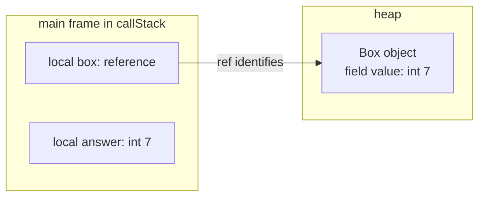

# How a trace represents execution

A trace is a collection of captured execution states. It connects source locations,
active method calls, variable values, reachable objects, and observed input/output.
This page explains those relationships using the `Main` and `Box` program from
[your first trace](../tutorials/first-trace.md). For a practical walkthrough, use
[Read a trace](../tutorials/read-a-trace.md).

## A source stop is a point in execution

The tracer compiles the submitted Java program and observes it through the debugger.
A snapshot records state at a debugger stop. A source-line stop can occur before
the statement on that line executes, so the highlighted line alone does not say
that an assignment has already taken effect. Comparing surrounding snapshots
reveals the change.

For example, at `int answer = box.value;`, the `box` local already refers to an
object, while `answer` is not yet present in the captured locals. At the next
source stop, `answer` holds the copied value. An absent local is not evidence that
Java initialized it to zero. Fields and array components have default values;
local variables must be assigned before use.

Source locations come from compiler/debugger information. A line can contain
several operations, and a loop can revisit the same line. Some source lines have
no executable location. The trace therefore is not a log of every bytecode
instruction or every memory operation.

## Null references and local visibility

A reference variable can be visible and hold `null`. It then refers to no object,
so there is no heap entry to follow from that value. A local not yet in scope has
no entry in the captured frame. In the tutorial, `answer` is also absent from the
debugger's visible locals at the stop before its initializing statement executes;
that absence is not an encoded null value.

For example, after `String label = null;` has executed and `label` is visible,
ordinary modern CLI JSON includes a variable entry such as
`{"name":"label","type":"java.lang.String","final":false}`. The missing
`value` property represents its null reference. Modern envelope, Java, and batch
JSON preserve the same entry with `"value": null`. In both cases the variable
exists in `locals`; an absent variable has no entry at all. Presentation filters,
scope, and available debugger information also affect which locals are shown,
so absence alone does not establish a Java value.

Python Tutor output records a visible null local explicitly: the frame's
`encoded_locals` includes `"label": null`, and its variable metadata remains
available in `locals_attrs`. The two formats express the same Java null value;
the modern ordinary-output omission is a serialization choice, not a different
program state. See the [modern variable fields](../reference/output.md#frame-and-variable-fields)
and [null-property rules](../reference/output.md#null-properties-in-modern-output).

## Frames and heap objects describe different parts of the state

In modern JSON, `callStack` describes captured method frames and their locals.
Primitive locals carry their values directly. A local that refers to an object
carries a `ref`; the matching entry in `heap` describes that object.

After the tutorial's assignment, the relationship is:

The arrow represents the reference held by `box`. `answer` holds the primitive
value copied from the field; it does not refer to that field. Changing the field
after this assignment would not change the already-copied local value.

Two references with the same identity in one result refer to the same object.
The heap representation keeps that relationship visible without copying the
object under every variable that refers to it. Identity values are opaque and may
change between runs; use them to follow relationships within a result.

[Trace shared references](../tutorials/trace-shared-references.md) walks through
a field mutation with two references to one object and an unchanged primitive copy.

The captured heap contains objects reachable from the captured stack and static
roots, subject to inspection policy and tracing limits. It is not a dump of the
whole JVM heap. The JSON representation describes captured program values rather
than physical object addresses or a complete memory layout.

## Selection, retention, and ordering answer different questions

Breakpoint selection chooses source locations to observe. Retention determines
which visits remain in the result. Selecting a print statement inside a loop can
therefore produce a single latest visit, an array of visits grouped at that
location, or a chronological sequence of selected visits. When the example
completes, chronological capture also retains the final main-exit state.

With no selected breakpoints or chronological option, ordinary tracing captures
the main-exit state when main returns normally. A directly thrown uncaught
exception in submitted code can supply the terminal state at the throwing line
instead. If the process ends through `System.exit` or an uncaught exception thrown
inside JDK code, default ordinary capture can fail without producing JSON because
no main-exit snapshot exists. Use chronological or selected-location capture to
retain the available states; see the
[CLI capture limitations](../reference/cli.md#capture-when-main-does-not-return).
The default view cannot show all intermediate assignments. With a selected
location and default retention, an earlier hit can be replaced by a later hit.
These are different views of an execution, not evidence that the program ran
differently. [Trace a loop](../tutorials/trace-a-loop.md) demonstrates all three
retention choices with the same program.

## Output is cumulative and depends on the result mode

Guest `stdout` and `stderr` belong to the traced program. In a chronological trace,
each capture carries the output observed up to that point. For a completed run,
the final capture contains the final output. Concatenating those fields from every
snapshot would repeat text already present in earlier prefixes.

Ordinary CLI selected-breakpoint output attaches final output to the last retained
hit in each bare line-number bucket, including when hits are accumulated. If
multiple source files share that selected line number, only the bucket's last hit
receives the final output; another file's retained hit can keep an earlier prefix.
Source locations and locals still describe their recorded stops, even when the
streams include text printed afterward. Read output according to the selected mode
rather than assuming every field describes one instantaneous observation. The
[output reference](../reference/output.md#input-and-output-observations) distinguishes
this ordinary CLI projection from envelope and Java/batch behavior.

For ordinary output, the tracer writes its own diagnostics to its process's stderr,
outside the JSON trace. Redirecting stdout saves that JSON while leaving ordinary
failure diagnostics visible in the terminal. With `--result-envelope`, job
diagnostics instead appear in the envelope's `diagnostics` array on stdout;
the tracer's terminal stderr can be empty even when the envelope reports failure.
Preflight and argument errors still use terminal stderr, and an unreadable
`--stdin-file` can fail before any envelope exists. Read both channels according to
the [CLI exit-status contract](../reference/cli.md#exit-statuses) and
[envelope contract](../BOUNDED_TRACING.md#envelope).

## Input is a consumption cursor

Guest input is a string separate from the source, supplied with `--stdin`,
`--stdin-file`, or the corresponding request field. Each job starts a fresh cursor
at the beginning of that string. A snapshot's `stdinConsumed` shows the prefix the
program has read so far, and `stdinOffset` is that prefix's length in UTF-16 code
units, not bytes.

What counts as "read" depends on the reader. For `java.util.Scanner` (`next*`,
`find*`, and `nextLine`), `java.io.BufferedReader.readLine`, and
`java.lang.IO.readln` on standard input, the cursor follows the program's logical
reads. After `Scanner.nextLine()` returns `Ada`, `stdinConsumed` is `Ada` followed
by a newline, even though the scanner has already buffered more input. Streams
from `BufferedReader.lines()` or `Scanner.tokens()` move the cursor through those
same reads. Methods that do not complete one of those reads, such as
`BufferedReader.read` or `Scanner.skip`, do not move it, so it can lag behind what
the program has read.

How other readers built on `System.in`, such as an `InputStreamReader`, are
observed depends on the guest. In a dedicated guest (CLI tracing and multithread
jobs), they are observed only at the underlying stream. Its buffering can move the
cursor past text the program has not used yet: one `InputStreamReader.read` of
three characters can report the entire supplied input as consumed, so treat the
cursor as an upper bound. Reads through a separately constructed
`BufferedInputStream` around `System.in` are not observed at all. In a reusable guest (single-stack Java API and batch
jobs), `InputStreamReader` reads and direct `System.in.read()` or
`System.in.read(byte[], int, int)` calls are not observed, so the cursor can lag
behind what the program has read. Of the direct stream reads, only the
single-argument `System.in.read(byte[])` advances it there.

The [output reference](../reference/output.md#input-and-output-observations) defines
the snapshot fields.

## Two representations of the same trace

The tracer can write captured states as Python Tutor JSON (`pytutor`) or modern
JSON (`modern`). Both serializers convert the same completed snapshots and receive
the same presentation options, so the format changes how a state is written, not
which states are captured. A result envelope's status and diagnostics are separate
from its format-specific trace payload. The
[null local](#null-references-and-local-visibility) described earlier is one
example: both formats record the same Java `null` and spell it differently.

Python Tutor JSON follows the trace format of **Online Python Tutor**. Each step in
a `trace` array holds a `stack_to_render` list of frames, whose `encoded_locals`
contain the values, plus step-level `globals` and `heap`. A reference is the tuple
`["REF", id]`, and each heap value is a tagged array whose first element names its
shape, such as `INSTANCE`, `LIST`, `DICT`, or `JAVA_LAMBDA`. `float`, `double`, and
`char` values are also tagged, for example as `NUMBER-LITERAL` or `CHAR-LITERAL`.
The tracer adds Java metadata alongside these values: `locals_attrs` and
`globals_attrs` hold declared types and `final` flags, `heap_attrs` holds heap
types, steps and frames identify their source `file`, steps record the input
cursor, and the root carries `sources` and `entryFile`. The
[Python Tutor format reference](../reference/output.md#python-tutor-format)
includes a complete example.

Modern JSON names each part explicitly. A modern step has a `callStack` of frames
whose `locals`, like the step's `statics`, are records with `name`, `type`, `value`,
and `final`. A reference is the object `{"ref": id}`, and `heap` is a map from
identity to an entry whose `kind` (`object`, `array`, `string`, `lambda`, `box`, or
`color`) says which payload field to read. Primitive values are plain JSON: a
`char` is a one-character string, and
[non-finite floating-point values](../reference/output.md#floating-point-special-values)
are the strings `"NaN"`, `"Infinity"`, and `"-Infinity"`. The
[modern format reference](../reference/output.md#modern-format) defines every field
and [heap kind](../reference/output.md#heap-fields-and-kinds).

The tutorial's `box` local shows the difference. With `42` as an illustrative
identity, modern JSON writes `box` as a variable record whose `value` is
`{"ref": 42}`, and the step's `heap["42"]` is an entry with `"type": "Main$Box"`,
`"kind": "object"`, and a `fields` array holding the `value` field's record.
Python Tutor JSON writes `"box": ["REF", 42]` in the `main` frame's
`encoded_locals`, keeps the declared type `Main.Box` in `locals_attrs`, and stores
the object as `["INSTANCE", "Main$Box", ["value", 7]]` in `heap["42"]`, with the
field type in `heap_attrs`. Both describe one reference to one object whose field
holds `7`.

The formats also differ in how they group snapshots. Ordinary selected-breakpoint
output in Python Tutor JSON is a root dictionary keyed by line number, whose values
are complete Python Tutor payloads. Modern JSON instead uses one root with a
`breakpoints` map. Envelope, Java, and batch payloads use a single sequence root in
both formats. Ordinary modern output omits unset properties and is always indented;
Python Tutor output keeps a null local as an explicit JSON null and is indented
only with `--pretty`. See
the [result contracts](../reference/output.md#result-contracts) and
[null-property rules](../reference/output.md#null-properties-in-modern-output).

Most presentation options apply to both formats. `--remove-main-args`,
`--remove-method-this`, and `--type-style`, along with their request-field
equivalents, affect either format. Primitive binary metadata is also available in
both. Each format places it with its other metadata: beside a modern variable or
heap entry, or inside Python Tutor's `locals_attrs`, `globals_attrs`, and
`heap_attrs` entries so that its tuples stay unchanged. See
[primitive binary metadata](../reference/output.md#optional-primitive-binary-metadata).
Inline strings are the exception. `--inline-strings` replaces each Python Tutor
string reference with the string's text and omits string heap entries. The output
then no longer shows which variables share a string object. Modern output ignores
the option, and its strings remain `string` heap entries reached by reference.

Thread capture has only one representation. Python Tutor JSON supports
single-stack capture only. The CLI therefore rejects `--multithread` without
`--format modern` (exit status 2), and batch and Java jobs report a validation
failure. Modern steps then add `threads`, `triggeringThreadId`, and thread event
labels such as `thread_start`; see
[opt-in thread capture](../reference/output.md#opt-in-thread-capture).

Python Tutor JSON came first. The
[1.0.0 release](https://github.com/cs1302uga/cs1302-tracer/releases/tag/v1.0.0)
emitted only that format.
[Release 2.0.0](https://github.com/cs1302uga/cs1302-tracer/releases/tag/v2.0.0)
added modern JSON as a separate object-graph schema that is not interchangeable
with it. Python Tutor JSON remains the default for the CLI `--format` option, an
omitted batch `format`, and the Java `TraceRequest(String)` constructor, so existing
commands keep their output. Neither format is deprecated; both are values of the
stable `TraceFormat` Java API.

Choose a format according to the program that reads it. Code that parses the JSON
itself can follow modern JSON's named fields and heap map without decoding tuple
tags. Thread capture requires modern JSON, and the tutorials and tracing recipes
also use it. Python Tutor JSON suits renderers built on Python Tutor's trace format
and consumers already written for it. Because the two schemas are not
interchangeable, a consumer reads only the format it was written for.

The project's visualizer,
[**cs1302-code-visualizer**](https://github.com/cs1302uga/cs1302-code-visualizer),
is one such renderer; it creates memory diagrams from Java programs. Its diagram
frontend derives from Python Tutor and reads Python Tutor JSON directly. It also
accepts modern JSON, which it first converts to the Python Tutor shape. That
conversion does not carry modern thread states. When the visualizer traces a
program itself, it produces Python Tutor JSON by default: it runs the tracer
without `--format`, and its batch jobs request `pytutor`. Prefer Python Tutor JSON
for traces you give it. Its own `--format` option selects an image format, such as
PNG or SVG, not a trace format.

The visualizer also depends on string identity. Its renderers generate traces
without inline strings, and its own string-style option controls how strings are
drawn. Its documentation notes that a trace generated with inline strings can
render only in its inline style. When it traces a program, it runs its own copy of
the tracer: each visualizer release pins one published tracer release by URL and
SHA-256 checksum and refuses to run a JAR that fails verification. Its diagrams
therefore come from the tracer release its own version pins, not from a
separately installed tracer.

## Captured evidence has limits

A trace can end because execution completed, failed, or reached a tracing limit.
A valid retained snapshot does not by itself establish that the entire program
completed. Result envelopes report completion and diagnostics alongside an
optional trace payload; ordinary traces have their own output and exit-code
contract. Use the [result-contract reference](../reference/output.md#result-contracts)
and [bounded tracing](../BOUNDED_TRACING.md) when interpreting incomplete results.

Single-stack exception snapshots still use the event label `step_line`; a second
snapshot at the throwing source line need not be a second execution of that
statement. An `exception` event label is available only in multithread capture.
Inspect captured guest stderr and structured result metadata instead of relying
on event names alone. Single-stack Java/batch jobs currently can report
`completed` and `complete: true` when an uncaught exception originates inside JDK
or binary-dependency code; its stack trace remains in guest stderr. The
[uncaught-exception reference](../reference/output.md#uncaught-exceptions)
explains these mode-specific limits.

Capturing state also does not isolate guest execution. The program still runs;
hosted untrusted submissions require the separate protections described in the
[runner contract](../RUNNER_CONTRACT.md).
