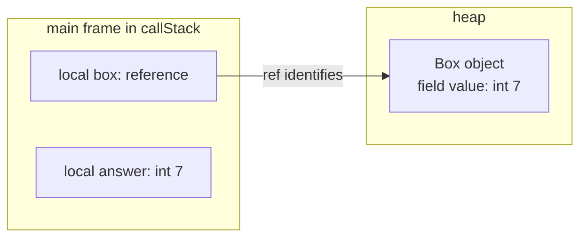

# How a trace represents execution

A trace is a collection of captured execution states. It connects source locations,
active method calls, variable values, reachable objects, and observed input/output.
This page explains those relationships using the `Main` and `Box` program from
[your first trace](../tutorials/first-trace.md). For a practical walkthrough, use
[Read a trace](../tutorials/read-a-trace.md).

## A source stop is a point in execution

The tracer compiles the submitted Java program and observes it through the debugger.
A snapshot records state at a debugger stop. A source-line stop can occur before
the statement on that line executes, so the highlighted line alone does not say
that an assignment has already taken effect. Comparing surrounding snapshots
reveals the change.

For example, at `int answer = box.value;`, the `box` local already refers to an
object, while `answer` is not yet present in the captured locals. At the next
source stop, `answer` holds the copied value. An absent local is not evidence that
Java initialized it to zero. Fields and array components have default values;
local variables must be assigned before use.

Source locations come from compiler/debugger information. A line can contain
several operations, and a loop can revisit the same line. Some source lines have
no executable location. The trace therefore is not a log of every bytecode
instruction or every memory operation.

## Null references and local visibility

A reference variable can be visible and hold `null`. It then refers to no object,
so there is no heap entry to follow from that value. A local not yet in scope has
no entry in the captured frame. In the tutorial, `answer` is also absent from the
debugger's visible locals at the stop before its initializing statement executes;
that absence is not an encoded null value.

For example, after `String label = null;` has executed and `label` is visible,
ordinary modern CLI JSON includes a variable entry such as
`{"name":"label","type":"java.lang.String","final":false}`. The missing
`value` property represents its null reference. Modern envelope, Java, and batch
JSON preserve the same entry with `"value": null`. In both cases the variable
exists in `locals`; an absent variable has no entry at all. Presentation filters,
scope, and available debugger information also affect which locals are shown,
so absence alone does not establish a Java value.

Python Tutor output records a visible null local explicitly: the frame's
`encoded_locals` includes `"label": null`, and its variable metadata remains
available in `locals_attrs`. The two formats express the same Java null value;
the modern ordinary-output omission is a serialization choice, not a different
program state. See the [modern variable fields](../reference/output.md#frame-and-variable-fields)
and [null-property rules](../reference/output.md#null-properties-in-modern-output).

## Frames and heap objects describe different parts of the state

In modern JSON, `callStack` describes captured method frames and their locals.
Primitive locals carry their values directly. A local that refers to an object
carries a `ref`; the matching entry in `heap` describes that object.

After the tutorial's assignment, the relationship is:

The arrow represents the reference held by `box`. `answer` holds the primitive
value copied from the field; it does not refer to that field. Changing the field
after this assignment would not change the already-copied local value.

Two references with the same identity in one result refer to the same object.
The heap representation keeps that relationship visible without copying the
object under every variable that refers to it. Identity values are opaque and may
change between runs; use them to follow relationships within a result.

[Trace shared references](../tutorials/trace-shared-references.md) walks through
a field mutation with two references to one object and an unchanged primitive copy.

The captured heap contains objects reachable from the captured stack and static
roots, subject to inspection policy and tracing limits. It is not a dump of the
whole JVM heap. The JSON representation describes captured program values rather
than physical object addresses or a complete memory layout.

## Selection, retention, and ordering answer different questions

Breakpoint selection chooses source locations to observe. Retention determines
which visits remain in the result. Selecting a print statement inside a loop can
therefore produce a single latest visit, an array of visits grouped at that
location, or a chronological sequence of selected visits. When the example
completes, chronological capture also retains the final main-exit state.

With no selected breakpoints or chronological option, ordinary tracing captures
the main-exit state when main returns normally. A directly thrown uncaught
exception in submitted code can supply the terminal state at the throwing line
instead. If the process ends through `System.exit` or an uncaught exception thrown
inside JDK code, default ordinary capture can fail without producing JSON because
no main-exit snapshot exists. Use chronological or selected-location capture to
retain the available states; see the
[CLI capture limitations](../reference/cli.md#capture-when-main-does-not-return).
The default view cannot show all intermediate assignments. With a selected
location and default retention, an earlier hit can be replaced by a later hit.
These are different views of an execution, not evidence that the program ran
differently. [Trace a loop](../tutorials/trace-a-loop.md) demonstrates all three
retention choices with the same program.

## Output is cumulative and depends on the result mode

Guest `stdout` and `stderr` belong to the traced program. In a chronological trace,
each capture carries the output observed up to that point. For a completed run,
the final capture contains the final output. Concatenating those fields from every
snapshot would repeat text already present in earlier prefixes.

Ordinary CLI selected-breakpoint output attaches final output to the last retained
hit in each bare line-number bucket, including when hits are accumulated. If
multiple source files share that selected line number, only the bucket's last hit
receives the final output; another file's retained hit can keep an earlier prefix.
Source locations and locals still describe their recorded stops, even when the
streams include text printed afterward. Read output according to the selected mode
rather than assuming every field describes one instantaneous observation. The
[output reference](../reference/output.md#input-and-output-observations) distinguishes
this ordinary CLI projection from envelope and Java/batch behavior.

For ordinary output, the tracer writes its own diagnostics to its process's stderr,
outside the JSON trace. Redirecting stdout saves that JSON while leaving ordinary
failure diagnostics visible in the terminal. With `--result-envelope`, job
diagnostics instead appear in the envelope's `diagnostics` array on stdout;
the tracer's terminal stderr can be empty even when the envelope reports failure.
Preflight and argument errors still use terminal stderr, and an unreadable
`--stdin-file` can fail before any envelope exists. Read both channels according to
the [CLI exit-status contract](../reference/cli.md#exit-statuses) and
[envelope contract](../BOUNDED_TRACING.md#envelope).

## Captured evidence has limits

A trace can end because execution completed, failed, or reached a tracing limit.
A valid retained snapshot does not by itself establish that the entire program
completed. Result envelopes report completion and diagnostics alongside an
optional trace payload; ordinary traces have their own output and exit-code
contract. Use the [result-contract reference](../reference/output.md#result-contracts)
and [bounded tracing](../BOUNDED_TRACING.md) when interpreting incomplete results.

Single-stack exception snapshots still use the event label `step_line`; a second
snapshot at the throwing source line need not be a second execution of that
statement. An `exception` event label is available only in multithread capture.
Inspect captured guest stderr and structured result metadata instead of relying
on event names alone. Single-stack Java/batch jobs currently can report
`completed` and `complete: true` when an uncaught exception originates inside JDK
or binary-dependency code; its stack trace remains in guest stderr. The
[uncaught-exception reference](../reference/output.md#uncaught-exceptions)
explains these mode-specific limits.

Capturing state also does not isolate guest execution. The program still runs;
hosted untrusted submissions require the separate protections described in the
[runner contract](../RUNNER_CONTRACT.md).
