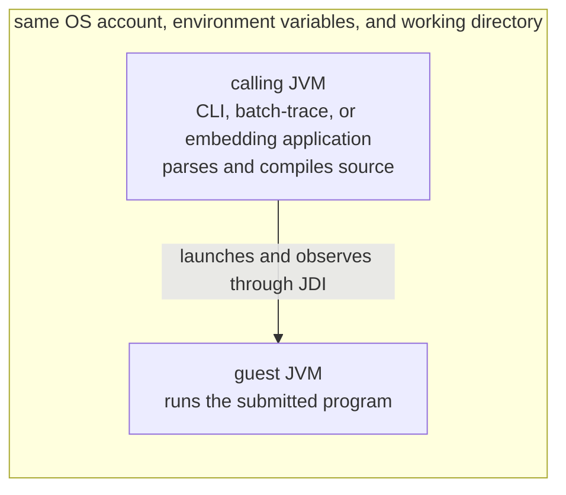

# Why the tracer is not a sandbox

The tracer learns what a Java program does by compiling it and running it under a
debugger. Nothing in that process limits what the program itself may do. This page
explains where submitted code runs, what it can reach, which tracer controls bound
tracing work without containing the program, and why hosted untrusted submissions
need a separate isolation boundary. The [runner contract](../RUNNER_CONTRACT.md)
states that boundary's requirements. [Bounded tracing](../BOUNDED_TRACING.md)
defines the budgets and inspection policies mentioned here.

## Tracing a program runs it

A trace is evidence of a real execution. To capture a snapshot, the tracer must
let the program reach that point. Every statement before it has already run,
including any file, network, or process operation. Capturing state observes
execution; it does not isolate it.

The documentation therefore sorts programs by whether you trust them, not by how
they are traced. Trusted instructor examples can be traced directly. Hosted
student submissions are treated as malicious by default. The whole job, including
source parsing and compilation, must then run inside an isolation boundary
([runner contract](../RUNNER_CONTRACT.md)). Tracing limits and `FIELDS` inspection
are useful controls inside that boundary; they are not the boundary itself.

A student's submission traced on an instructor's workstation is still someone
else's program. As the rest of this page explains, it runs with the instructor's
account, environment, and files.

## A job spans the calling process and a guest JVM

Every trace involves two JVMs. The calling process is whatever invoked the
tracer: the CLI's JVM for `trace`, the `batch-trace` JVM, or an application that
calls the Java API. It reads, parses, and compiles the submitted source, and it
prepares any binary dependencies. It then launches the guest, a separate JVM that
runs the compiled program while the calling process observes it through the Java
Debug Interface (JDI).

A dedicated guest runs one CLI `trace` invocation or one multithread job. A
reusable guest runs a harness that loads each single-stack job for `Tracer.trace`,
`batch-trace`, and `BatchTracer`. [Guest modes](../BOUNDED_TRACING.md#guest-modes)
describes their lifetimes. Both kinds start through one launcher that uses JDI's
default launching connector. The guest runs the calling JVM's own **JDK**, from
its `java.home`, so the Java API needs
[permission to launch a child JVM](../reference/java-api.md). The launch options
select headless AWT mode and the guest class path. When needed, they also select a
dependency class loader and preview features. None of them restricts the guest.

The tracer does not choose the debugger connection's transport. The connector
does. For Linux, the runner contract documents it as loopback TCP: while launching
each guest, the tracer listens on `127.0.0.1` at an ephemeral port, and the guest
connects to `localhost`. The listener is local but not private. Any process that
shares the loopback interface can connect while a guest launches. For that reason
the runner contract gives each job its own network namespace
([backend responsibilities](../RUNNER_CONTRACT.md#backend-responsibilities)).

## Untrusted source reaches the calling process first

Exposure begins before any guest exists. JavaParser and **javac** parse and
compile the submitted text inside the calling JVM. For an embedding application,
that is the application's own process. Breakpoint discovery works the same way:
it compiles the source and reads line tables without launching a guest. Not
running the program does not make hostile input safe
([discover breakpoints](../reference/java-api.md#discover-breakpoints)).

The tracer narrows what this host-side work executes. Compilation disables
annotation processing and uses an empty processor path. Breakpoint discovery
reads compiled class files without loading them. Dependency bytecode supplies
type evidence without loading dependency classes into the calling process
([binary dependency boundaries](../contributing/security-analysis.md#binary-dependency-boundaries)).

These choices limit what runs in the calling JVM, but they do not bound its
resources. Source-size limits cap the submitted text. The tracing deadline,
however, does not cover parsing or compilation. Nothing in the tracer bounds
their memory use, and recursion inside JavaParser and javac is not fully
constrained ([nesting boundaries](../contributing/security-analysis.md#nesting-boundaries)).

## The guest runs with the caller's identity and context

The launcher sets the guest's main class, class path, and the options described
above. It does not set an environment, a working directory, an operating-system
account, heap or stack sizes, or a temporary directory. The guest therefore
starts as an ordinary child of the calling process:

- It runs as the same operating-system user, with that account's file and network
  access.
- It sees the caller's environment variables, including any credentials stored
  there.
- It starts in the caller's working directory, so relative paths in guest code
  resolve there.
- JVM options supplied through the environment, such as `JAVA_TOOL_OPTIONS`, apply
  to the guest as well. The tracer removes the JVM's "Picked up" banner from
  captured guest stderr; it does not remove the options.
- Its heap size follows JVM defaults or those inherited options, because the
  tracer passes no memory settings.

The tracer adds no confinement of its own. It installs no Java security policy,
filesystem restriction, network policy, or process limit. Guest code can read and
write files, open network connections, and start processes like any Java program
run by that account. The inspection policies, for example, control how the tracer
observes guest state, not the operations guest code performs.

The working directory also shapes the calling process's work. Under the default
`TRUSTED` inspection, CLI jobs read from standard input discover neighboring
sources starting from the working directory
([source input and discovery](../reference/cli.md#source-input-and-discovery)).
Relative class-path entries resolve against the same directory
([binary dependencies](../reference/java-api.md#binary-dependencies)). The place
where the tracer runs therefore affects both what it compiles and what guest code
reaches through relative paths.

The guest's standard streams are the one part of its context the tracer replaces.
They are pipes to the tracer, not the caller's terminal. A dedicated guest
receives the supplied input, and its standard input is then closed. A reusable
guest reads each job's input from memory. The tracer drains stdout and stderr into
the job's result. This redirection lets the tracer observe each job's
[input and output](../reference/output.md#input-and-output-observations). It does
not restrict other files or devices the guest opens.

## Budgets bound tracing work, not the job

Tracing budgets let a trace finish with bounded effort and a bounded result. Each
budget counts something the tracer does: elapsed tracing time, captured snapshots,
retained output bytes, inspected heap objects and elements, and accounted
snapshot storage ([limits](../BOUNDED_TRACING.md#limits)). Exceeding a count
stops the trace. The budgets do not measure or limit the job as a whole.

The deadline shows the difference. It starts when the job enters the trace phase,
after source reading, parsing, compilation, and dependency preparation. A
dedicated guest's launch falls inside it. A reusable guest starts before that
phase and is bounded instead by a fixed startup-handshake timeout. The watchdog
that enforces the deadline is a daemon thread inside the calling JVM, so it runs
only while that process does. A timeout of zero disables it, and CLI envelope and
batch requests leave omitted limits unlimited
([guest modes](../BOUNDED_TRACING.md#guest-modes)).

Memory budgets follow the same pattern. Retained trace bytes are deterministic
accounting of captured snapshot data, not a measurement of process memory. They
do not cover compiler, parser, JDI, or JVM allocations. The guest's heap is set
by JVM defaults, and the calling process's heap by however that JVM was started.
Source limits cover submitted text, not binary dependencies or copied resource
trees. No budget limits CPU time, disk use, or the processes a guest starts.

## Stopping a trace ends only the guest JVM

When a limit, cancellation, or failure stops a job, the tracer forcibly destroys
the guest JVM process. Its stop and cleanup paths act on that one process. They
do not look for or terminate processes the guest started. The tracer also
registers no shutdown hook. If the calling process is itself killed, the tracer
does not stop its guest. The runner contract warns that the guest JVM can keep
running after reparenting.

Temporary files follow the same pattern. The calling JVM writes prepared sources,
compiled classes, and optional dependency copies under temporary directories in
its own `java.io.tmpdir`. The CLI's JDK version probes also write a short-lived
output file. Normal completion and handled failures remove these files; a killed
process leaves them behind. The guest does not inherit a `-Djava.io.tmpdir`
setting given to the calling JVM, so temporary files that guest code creates use
the platform default.

## Inspection and reuse are not isolation

Inspection policy decides how the tracer reads guest state, not what guest code
may do. Under `TRUSTED`, the tracer calls guest methods such as `toArray` and
`entrySet` to present collections and wrappers. Capture can then run program code
that changes state or blocks. The watchdog can still end the guest while such a
call is stuck. `FIELDS` reads fields instead of calling those methods, and it
limits source discovery to submitted sources.

Despite its name, `TRUSTED` is not a security level, and neither policy provides
process isolation. `TRUSTED` is the default for the CLI, batch requests, and the
`TraceRequest(String)` constructor. Avoiding tracer-initiated calls is still
useful inside an isolation boundary, where the runner contract prefers `FIELDS`.
[Inspection policies](../BOUNDED_TRACING.md#inspection-policies) describes both
policies in full.

Reusable guests separate jobs by class loader, not by process. Each job loads its
classes through a new class loader in its own thread group. Between jobs, the
harness restores system properties, default locales and time zone, standard
streams, and the default uncaught-exception handler. Other JDK-global state can
remain visible to later jobs in that guest, and filesystem changes persist unless
the caller removes them
([guest reuse between jobs](../reference/batch.md#guest-reuse-between-jobs)).
One job per worker gives each job a fresh guest JVM. The calling process, its
account, and the host filesystem remain shared.

## Whole-job isolation belongs to the runner

Exposure begins with parsing and extends to every process the guest starts. An
isolation boundary must therefore enclose the whole job: the calling process, the
guest JVM, the CLI's version probes, and their descendants. The
[runner contract](../RUNNER_CONTRACT.md) describes that boundary for a Linux
submission runner and supplies what the tracer lacks:

| Concern | Without a runner | Added by the runner contract |
| --- | --- | --- |
| Identity and environment | The caller's account, environment, and working directory | A nonprivileged identity, a minimal environment without secrets that still includes a full JDK, and a private disposable workspace |
| Resources | Budgets that bound tracing work | Enforced CPU, memory, process, disk, and output limits for the whole job |
| Time | A tracing deadline enforced by a thread in the calling JVM | A whole-job deadline independent of the tracer's threads |
| Files and network | No restriction | Filesystem and network policy, with a network namespace per job |
| Termination and cleanup | The guest JVM is destroyed; temporary files remain if the process is killed | Termination of the whole containment unit, then removal of its workspace and private temporary filesystem |

The contract also asks for admission control across jobs and for one disposable
tracer process per job. Each job uses `FIELDS` inspection and explicit finite
limits in every integration mode
([job interface](../RUNNER_CONTRACT.md#job-interface)). The tracer and guest share
one job boundary, so the contract treats the job's stdout and result JSON as
untrusted data, not an attestation of success.

This repository does not implement or validate an isolation backend, and the
current release makes no hosted isolation claim. The tracer's own controls remain
useful inside such a boundary, but they cannot replace it.
