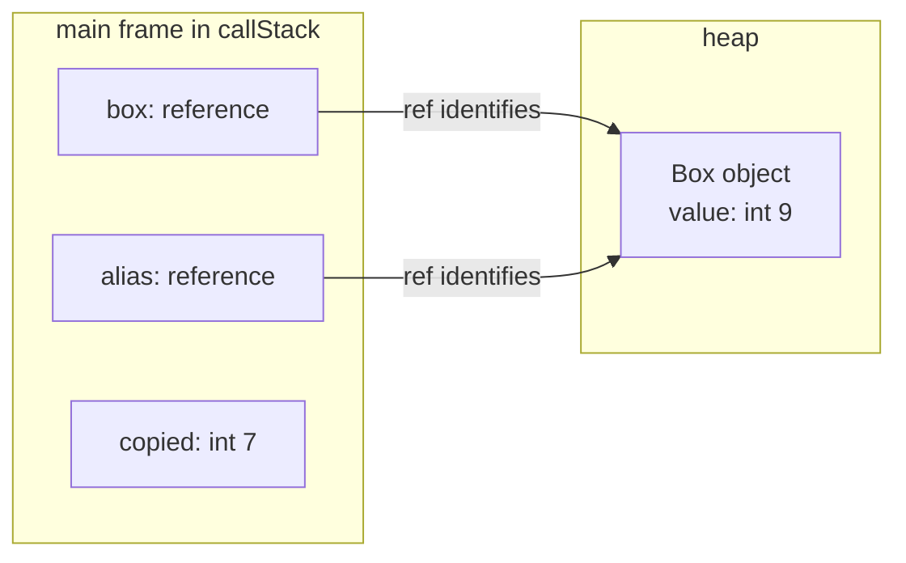

# Trace shared references

Trace a field mutation through two variables that refer to the same object. You
will follow both references into the heap and compare the changed field with a
primitive value copied before the mutation.

Start after [Read a trace](read-a-trace.md), in the directory containing
`code-tracer.jar`. Use the full **JDK 21 or later** selected during
[installation](../guides/installation.md#verify-your-installation). The command
below works in **Bash**, **PowerShell 7.4+**, and **Command Prompt**. You only need
the JAR and a text editor; save this example in a new file alongside `Main.java`.

## Create a program and predict its output

Save these exact fourteen lines as `SharedReferences.java` beside the JAR. Keep
each statement on its own line so the checkpoints below match your source.

<!-- shared-source:start -->
```java
public class SharedReferences {
    static class Box {
        int value = 7;
    }
    public static void main(String[] args) {
        Box box = new Box();
        Box alias = box;
        int copied = box.value;
        alias.value = 9;
        System.out.println(box.value);
        System.out.println(alias.value);
        System.out.println(copied);
    }
}
```
<!-- shared-source:end -->

Before running it, write down a prediction for the three printed values. Consider
what each assignment copies: does `alias` refer to another object, and does
`copied` change when the object's field changes? Use the trace to check your
reasoning.

## Capture the execution

Run this command in the directory containing `SharedReferences.java` and
`code-tracer.jar`:

<!-- shared-command:start -->
```sh
java -jar code-tracer.jar trace -i SharedReferences.java --all-breakpoints --format modern --pretty > shared-references.json
```
<!-- shared-command:end -->

A successful command exits with status `0`. Open `shared-references.json` in a
text editor. Check that its root has `"format": "modern"`,
`"entryFile": "SharedReferences.java"`, and a `sources` entry containing your
source. The `steps` array holds snapshots in execution order.

The program's printed output is captured inside the JSON. Tracer diagnostics go
to the terminal's stderr. If the command fails or the file is empty, use
[troubleshooting](../guides/troubleshooting.md) before continuing.

## Follow the two references

For each checkpoint, find a step whose `file` is `SharedReferences.java` and whose
`line` matches the table below. In its `callStack`, find the frame with
`"methodName": "main"` and inspect that frame's `locals`. A source-line stop shows
the state **before** its statement executes. The trace also includes constructor
stops, so use source locations rather than fixed positions in `steps`.

| Source line | What to find before the statement executes |
| --- | --- |
| `7` | `box` refers to an object whose `value` field is `7`. Neither `alias` nor `copied` is present yet. |
| `9` | `box` and `alias` refer to the same object. Its field is still `7`, and the primitive local `copied` is `7`. |
| `10` | Both references still identify the shared object. Its field is now `9`, while `copied` is still `7`. |

Start with line 7. Find the `box` local's `value.ref`, then look up the matching
key in that snapshot's `heap` map. JSON object keys are strings. The entry has
`kind` equal to `object` and type `SharedReferences$Box`. In its `fields` array,
find the field named `value` and confirm that it contains `7`.
The missing `alias` and `copied` locals are not default `null` or zero values:
their declarations have not executed yet.

Next, at line 9, compare the `value.ref` numbers in the `box` and `alias` locals.
They are equal. Follow either reference to the same heap entry and confirm that
its field is still `7`. Find `copied` in the same frame: its type is `int` and its
value is `7`.

`Box alias = box;` copied the reference value held by `box`. The two local
variables refer to one object; that assignment did not create another `Box`.
Reference numbers can differ between runs. Compare the two locals and the heap
key within each snapshot instead of looking for a particular number.

## Observe the mutation

At line 10, follow both references again. They still lead to the same heap object,
but its `value` field now contains `9`. The assignment on line 9 changed the
field through `alias`, so reading the field through `box` also gives `9`.

Find `copied` again: it remains `7`. The earlier assignment read the primitive
field value and copied it into this local. The local does not refer to the field,
so changing the field does not change the local.

This diagram represents the line-10 snapshot:



Both arrows identify one object. `copied` holds a primitive value and has no
reference arrow. This is a picture of the captured values and their relationships,
not a physical memory layout.

## Check your prediction

In the line-10 snapshot, `stdout` is still empty: the first print has not executed
yet. Find the final main-exit capture at line 13. Its `stdout` contains:

<!-- shared-output:start -->
```text
9
9
7
```
<!-- shared-output:end -->

Each value is followed by a newline, shown as an escaped newline in the JSON
string. Compare these values with your prediction. The first two prints read the
same object's current field; the third reads the primitive value copied earlier.
Use the final captured `stdout` rather than concatenating the output from every
snapshot, because captured output is cumulative.

You have now used reference identity, heap fields, and primitive locals to explain
the result. For the underlying representation, read
[How a trace represents execution](../explanation/trace-model.md#frames-and-heap-objects-describe-different-parts-of-the-state).
Continue with [Trace a loop](trace-a-loop.md) to compare repeated visits to one
source line, or use [Tracing programs](../guides/tracing.md) for your own example.
